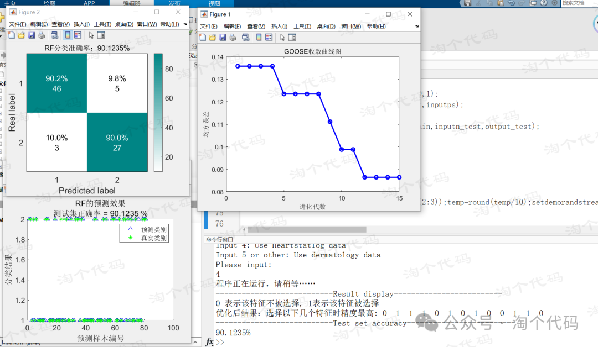
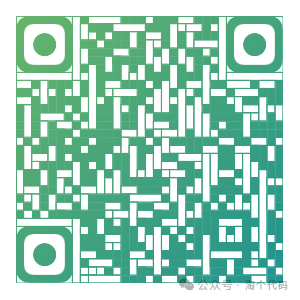
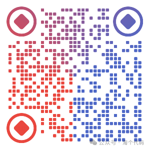

# 7 New Algorithms for Feature Selection in 2024, Optimizing SVM Parameters Simultaneously, Tested on 5 UCI Data, Aggregating 3 Classifiers, Carefully Organized!

In this issue, seven types of 2024's latest intelligent optimization algorithms are used to implement feature selection. Five commonly mentioned UCI datasets in the papers are used for validation, and three basic classifiers are employed to construct fitness functions.
Among them, 7 new algorithms for 2024 are: Goose Optimization Algorithm (GOOSE), Horned Lizard Optimization Algorithm (HOLA), Hippopotamus Optimization Algorithm (HO), Parrot Optimization Algorithm (PO), Bumblebee Optimization Algorithm (BFO), Crowned Hedgehog Optimization Algorithm (CPO), and Love Evolution Algorithm (LEA). Additionally, there are 3 classic algorithms: Particle Swarm Optimization, Genetic Algorithm, and Grey Wolf Algorithm.
5 UCI datasets are respectively: wine, sonar, dermatology, Heartstatlog, BreastEW.
These five UCI datasets are frequently seen in literature on feature selection and are classic and commonly used datasets! The table below:
UCI Datasets:
3 common classifiers: KNN, SVM, and Random Forest (RF).
References
Ye Yubin, Wei Wenshan. Feature selection method based on multi-strategy integrated Penguin optimization algorithm [J/OL]. Microelectronics and Computer, 2023, (12): 19-25 [2024-03-05].
[2] Xu Ming, Long Wen. Feature selection method based on multi-strategy integrated gray wolf optimization algorithm [J]. Science and Technology and Engineering, 2021, 21(20): 8544-8551.
Feature selection, also known as feature subset selection or attribute selection, is a crucial preprocessing step in machine learning for classification, regression, and data mining. The goal of feature selection is to use a method to remove redundant and irrelevant features from the dataset, aiming to find the optimal feature subset. It not only reduces the dimensionality of the data but also improves the efficiency of machine learning algorithms and selects the most useful features for classifier performance from the original dataset, enhancing its classification accuracy.
There are many papers online about feature selection! However, like this paper, which organizes it so comprehensively, is quite rare!
The code directory is shown below:
\n        \n      A total of three script files are present, each corresponding to a classifier. Running these three script files will allow you to freely modify the algorithm within the code!
Code functionality introduction:
\n        \n      After executing the code, it prompts you to enter a corresponding number to change different datasets, making it very convenient!
Furthermore, to facilitate the modification of intelligent optimization algorithms, the code has been integrated accordingly. For example:
Moreover, if you want to add any other algorithm, just add an algorithm name here and then copy the corresponding algorithm into the directory.
Let's take a look at the code effects now!
This one uses the KNN classifier with the Dermatology dataset and implements feature selection using the BFO fish optimizer.
\n        \n      This one uses the RF classifier with the Heartstatlog dataset and implements feature selection using the GOOSE goose algorithm.
This one uses the SVM classifier with the Break Cancer dataset and implements feature selection using the LEA love evolution algorithm.
For this code, please click on the provided link:
Or you can scan the QR code to get it.
The code has been added to the Fault Diagnosis All-in-One Kit,
Fault Diagnosis All-in-One Kit download link:

## Images

<!-- PAYMENT_BLOCK -->

## Get this dataset

- Payment link (Stripe): [Buy now](https://buy.stripe.com/3cs8yP7sY87d0vu9AB)
- Payment QR code: 

<!-- /PAYMENT_BLOCK -->
